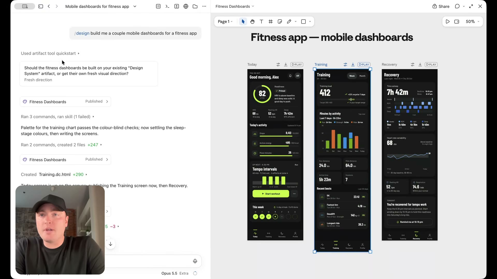
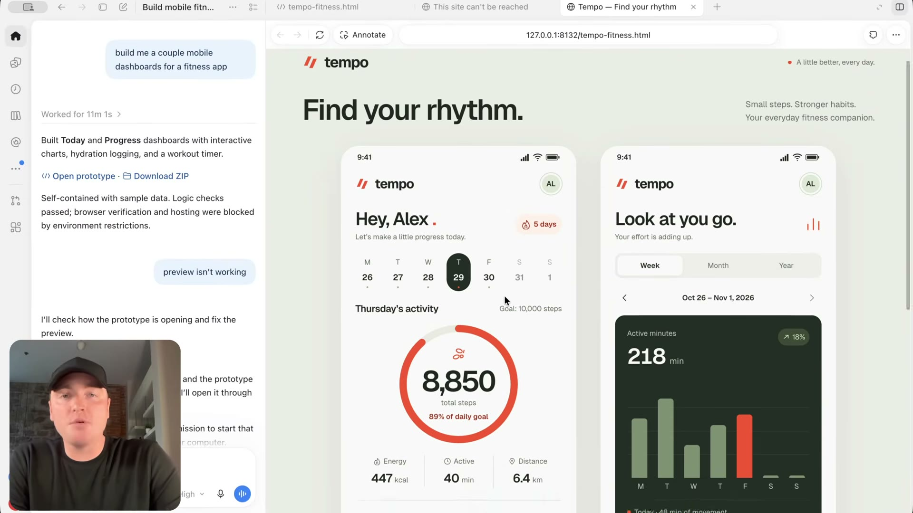

# Claude Code ve Codex örnekleri

[00:32–01:56](https://www.youtube.com/watch?v=uzQCZD3w3hs&t=32s)

Aynı mobil pano isteminin düzenlenebilir canvas ve yerel HTML önizlemesi üzerinden farklı çalışma yüzeyleri gösteriliyor.

## İlgili konuşma

[00:32] And right away, the different workflows and methods that you might follow might change depending on what tools that you have access to.

[00:38] We're going to start off here in Claude Code because it has a little bit more of a unique value prompt, and then look at some other tools.

[00:44] Now, we're going to run this prompt, and what I did here is I invoked this slash design skill.

[00:49] This here is unique to Claude Code and unique to Anthropic, and we're just going to run this very simple prompt, build me a couple mobile dashboards for a fitness app.

[00:58] Let's run.

[00:58] And then I'm going to run that exact same.

[01:00] prompt inside of ChatGPT Codex.

[01:02] It's included in your ChatGPT subscription, but it's another popular AI tool that's out there.

[01:07] Let's run.

[01:08] And inside of Claude Code, because we invoked that design skill, and even if you don't invoke the design skill, this is still going to happen anyway, is what we get is this Claude Design type canvas inside of Claude Code.

[01:21] So that answers a couple questions here.

[01:23] You really don't need Claude Design anymore because Claude Code can do everything.

[01:27] And at the same time, here we have this canvas.

[01:30] This is the canvas type functionality where we can move things around, we can drag things around, we can make tweaks to things as we see that we need fit, we can change the color, we can change the radius.

[01:38] This is more the canvas type functionality that designers are used to.

[01:43] And the result that we get in Codex, first off, it looks pretty good, but this here is ran locally.

[01:48] This is just an HTML file.

[01:49] So I can't move things around with that canvas type functionality like what we just saw in Claude Code.

[01:54] It's a little bit less ideal.

## İlgili kareler

Claude Code örneğinde üç koyu mobil fitness panosu ve üstte canvas araç çubuğu görülüyor.

Codex örneğinde yerel HTML önizlemesi olarak açık renkli iki mobil fitness ekranı gösteriliyor.
