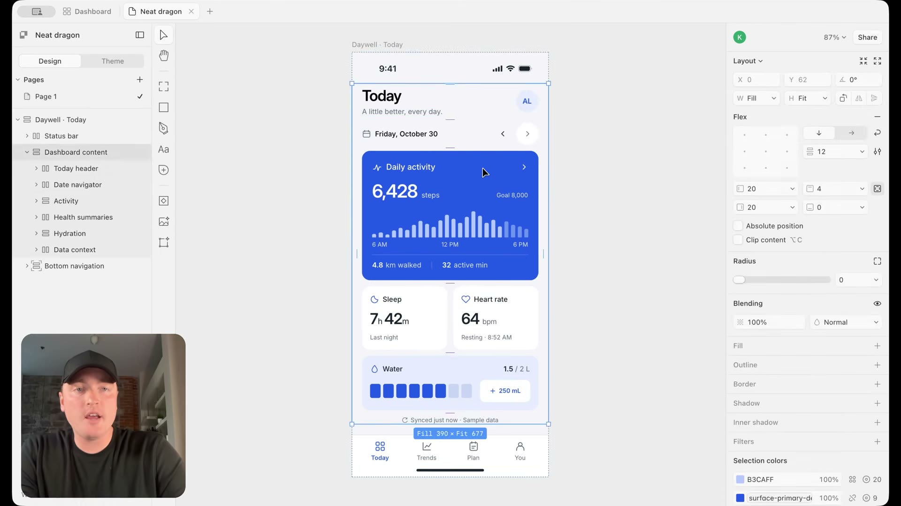

# Paper ile görsel çalışma alanı

[01:56–02:54](https://www.youtube.com/watch?v=uzQCZD3w3hs&t=116s)

Paper MCP bağlantısı, tasarımı katmanlarla düzenlenebilir bir canvas içinde ele almanın yolu olarak anlatılıyor.

## İlgili konuşma

[01:56] And if you don't have access to Claude Code with that canvas type functionality, you're not going to be able to do that.

[02:00] So I'm going to go ahead and add that to Codex.

[02:01] And I'm going to go ahead and add that to Codex.

[02:03] And you'll see that the canvas type functionality is a tool like Paper can really come in handy.

[02:08] And I'll link this down below.

[02:10] What Paper is is essentially a design interface for your AI agents.

[02:15] So you can connect the Paper MCP.

[02:17] And what your agents will do is actually send the designs to the Paper canvas so you can iterate from there.

[02:22] And to connect your different AI tools, download the Paper desktop app and you'll see prompts in order to, or instructions on how to connect your agents.

[02:28] So I'm going to go ahead and choose to add this to Codex.

[02:30] I'm just going to run this simple prompt inside Paper, build me a mobile dashboard for a health application, something like that.

[02:35] Let's run.

[02:35] And what we now have inside of Paper is those designs that Codex produced, but in that canvas type functionality.

[02:42] So we can come in here, we can change tokens, we can move things around.

[02:46] We can change text very similar to what we saw that Claude Code had in that canvas type functionality.

[02:52] It's just in a different application.

## İlgili kareler

Paper canvas içinde günlük aktivite kartı seçili; katman ağacı solda, yerleşim özellikleri sağda.
