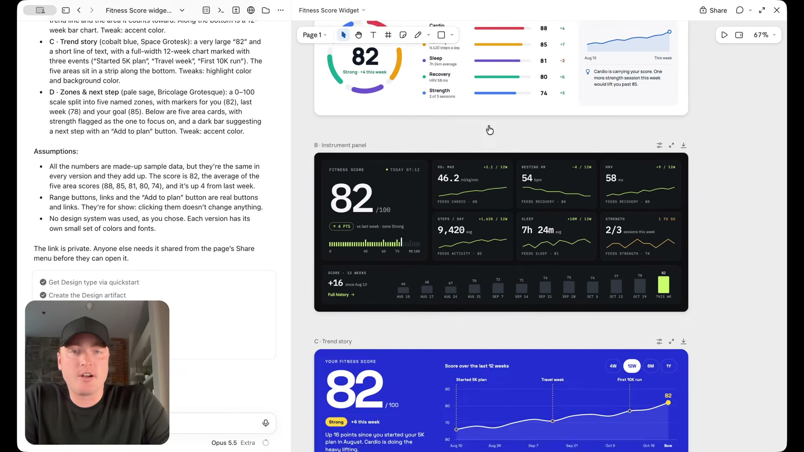
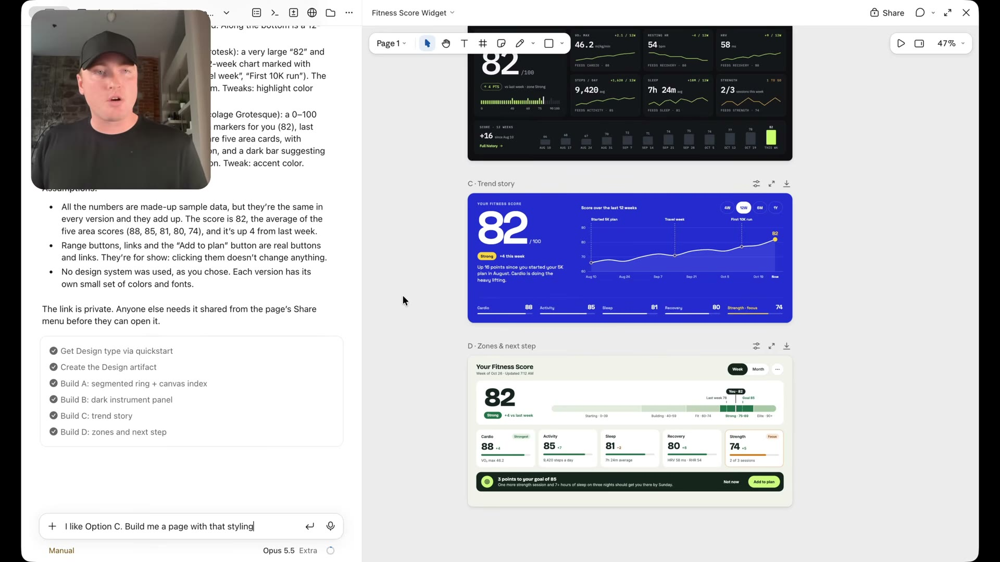

# Önce ana bileşen, sonra sayfa

[02:54–05:22](https://www.youtube.com/watch?v=uzQCZD3w3hs&t=174s)

Ana fitness skoru bileşeni için dört görsel yön deneniyor; seçilen yönün etrafında sayfa kurulması öneriliyor.

## İlgili konuşma

[02:54] Moving back to the output that we got with Claude Code is there's a fundamental difference between designing for mobile

[02:59] and designing for desktop.

[03:01] Regardless of whatever AI tool that you're using, the results that you get for mobile always tend to be a little bit better.

[03:07] Like there's less space for AI to overthink.

[03:10] What I want to go through now is a specific workflow that I like to use.

[03:14] And earlier in the summer, like I chatted with a bunch of senior designers at top companies.

[03:19] And what I'm about to show you is a workflow that they use as well when it comes to building desktop designs with AI to keep AI on track and avoid a lot of sloppy AI designs that happen.

[03:29] When you tell AI to build a desktop design right out of the gates.

[03:33] And where that difference is, is instead of focusing on the entire page like we did with mobile, because again, as you saw, we got pretty good results.

[03:39] We're going to focus on widget by widget,

[03:41] ideally starting off with the most important widget that a user might see on the page.

[03:45] So we're going to run this prompt, design four distinct variations of a full width, your fitness score widget for a desktop app.

[03:52] Explore different layouts, visual styles and ways to present the score and supporting fitness metrics.

[03:56] Let's run.

[03:57] And what we get back are four very

[03:59] different styles and treatments of whatever that main widget is on a particular dashboard.

[04:07] So we have the segmented ring.

[04:08] I don't like this one. This one feels very generated.

[04:11] This one here looks a little bit better.

[04:13] I like this trend story one with the big metric.

[04:16] Then we have your fitness score one.

[04:18] Now, this really comes in handy if we don't know what it is that we're looking for,

[04:23] because instead of having to burn a bunch of time and a bunch of our valuable tokens,

[04:29] we're going to have to spend a lot of time on generating entire page designs if we don't even know if we're going to like the treatment that it comes up with by focusing on the main widget to start.

[04:41] What you can do is then you can then build the rest of the page around the widget that you like and start to tweak these widgets until you land on something that you're really happy with before you generate the full entire page.

[04:53] And you can do this inside of any tool.

[04:55] You just might not have that canvas type functionality.

[04:57] As we looked at,

[04:58] but let's say I've gone through I've made some tweaks to option C here and now I'm ready to proceed for the entire page.

[05:05] We can then have it build a page based on the styling that we settle.

[05:08] See the value in this workflow.

[05:10] Now, we're not having to spend a ton of time and a ton of tokens generating a bunch of different page designs.

[05:15] We're focusing on the main widget, narrowing down the styling, the look,

[05:18] the feel, the treatments that we like, and then building that page to support it.

## İlgili kareler

Fitness skoru için farklı görsel yönler: koyu gösterge paneli ve mavi, büyük metrikli trend anlatımı.

Dört fitness skoru yaklaşımı aynı canvas üzerinde inceleniyor; seçilecek görsel yönün bağlamı korunuyor.
