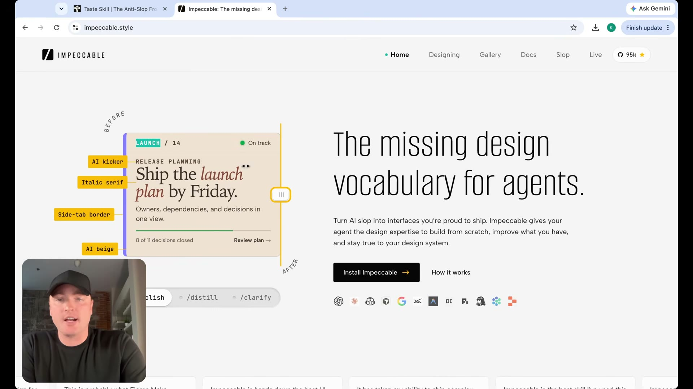
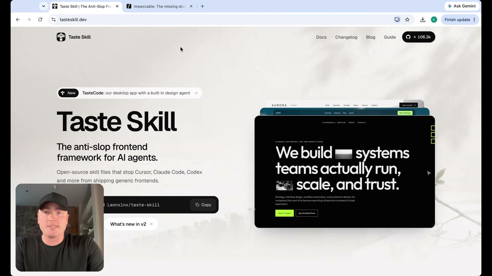

# Impeccable ve Taste Skill

[06:11–06:53](https://www.youtube.com/watch?v=uzQCZD3w3hs&t=371s)

İki beceri, tasarım yönlendirmesi ve kalıp görünümün azaltılması için örnek gösteriliyor.

## İlgili konuşma

[06:11] There's two open source skills, the taste skill and Impeccable.

[06:15] I'll link these down below,

[06:16] which help us reduce a lot of AI generated treatments.

[06:19] And to look at Impeccable just as an example is they kind of operate the same.

[06:23] Whereas before, you might have this very clearly

[06:26] AI generated

[06:28] cards like this is the definition of AI slop right here with the rounded corners,

[06:32] the border on the left, the difference, you know, the italicized font.

[06:36] That's a different color.

[06:38] And when you call Impeccable or you call it a taste skill, what it will do is it

[06:42] will reduce those AI treatments to restore a lot of the originality

[06:45] and designs that AI tends to drift away from.

[06:48] And now there's a bunch of open source skills like these out here.

[06:50] So the taste skill and Impeccable, these are arguably the most popular.

## İlgili kareler

Impeccable sitesinin ana sayfası ve tasarım becerisi tanıtımı görülüyor.

Taste Skill sitesinin ana sayfası ve arayüz örnekleri görülüyor.
