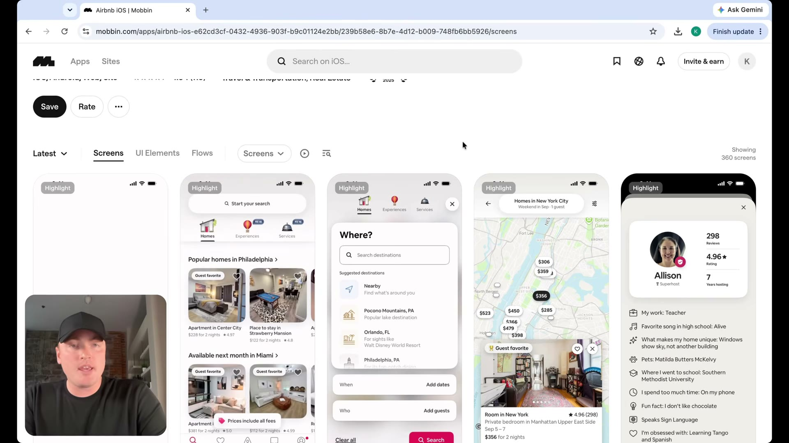
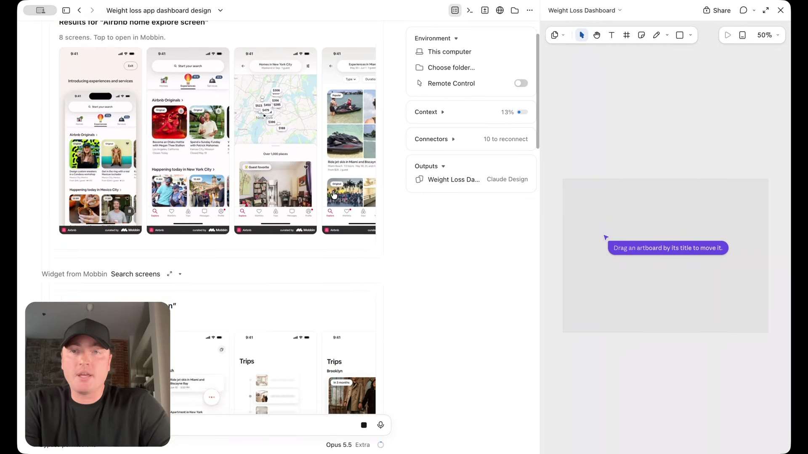
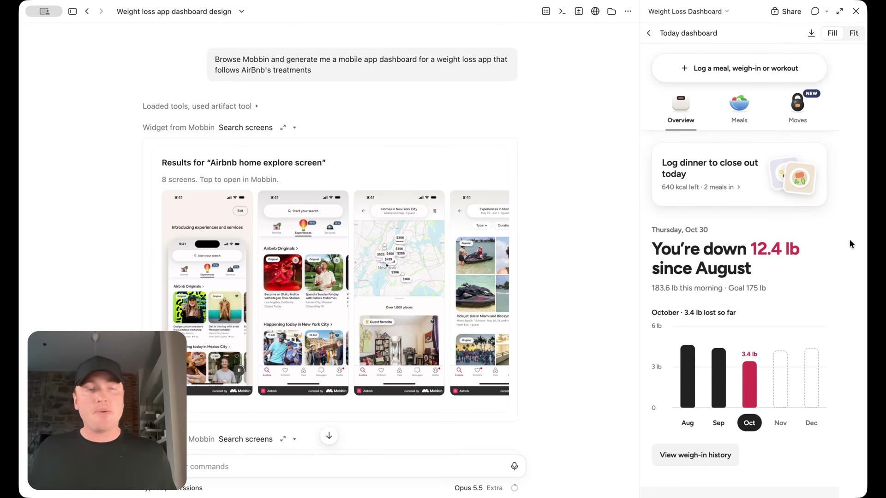
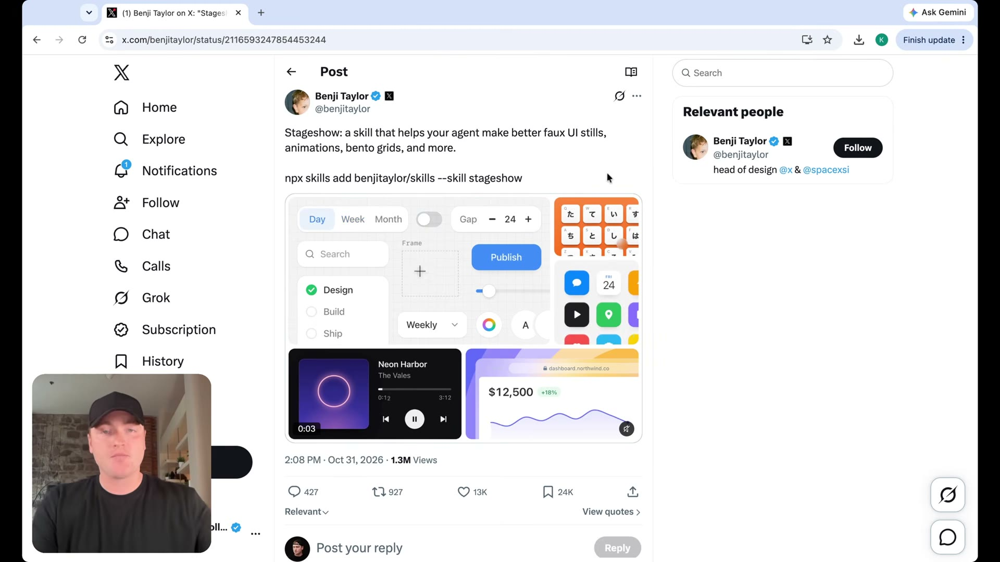

# Mobbin ile iki tür referans

[06:53–09:21](https://www.youtube.com/watch?v=uzQCZD3w3hs&t=413s)

Airbnb görsel dili ile kilo verme uygulamalarının bilgi düzeni referans alınarak mobil pano üretiliyor.

## İlgili konuşma

[06:54] And the other way I like to reduce AI slop is using Mobbin

[06:58] as a connector to give me access to over 600,000 real world screens.

[07:04] What Mobbin is essentially a massive

[07:05] repository of every app, screen, flow, UI element that's out there.

[07:10] As I said, it's about 600,000.

[07:11] What we can do is we can connect AI to all of these different screens and have

[07:17] it reference what's here in their library to help inform the treatments that it produces.

[07:22] So as an example, if I really like, let's say what Airbnb does for their designs, I

[07:28] can connect Mobbin MCP and have it reference Airbnb's visual style to build something

[07:35] relatively similar. And if you've never used Mobbin before,

[07:37] I'll link that in the video description as well.

[07:39] And one thing that's nice, too, is Mobbin has connectors and plug ins

[07:43] at all of these popular AI tools, whether using Grok, Claude Code, Codex.

[07:48] They have a native plug in or a connector.

[07:51] So it's really easy to set up.

[07:53] What we're going to do is we're going to run this prompt to browse Mobbin MCP or

[07:58] Mobbin MCP there, browse Mobbin and generate me a mobile app dashboard for a

[08:02] weight loss app that follows Airbnb's treatments.

[08:04] Let's go ahead and run.

[08:05] And while it's generating, you can see what it's doing.

[08:08] So what it did is it pulled up the Airbnb app screens to understand the visual style.

[08:13] But then it also looked up designs inside of Mobbin for weight loss app dashboards

[08:19] to understand the type of information that tends to be displayed and how things tend

[08:24] to be laid out on these particular dashboards.

[08:26] So it builds something realistic.

[08:28] It's still understanding and applying the Airbnb styling on the right hand side.

[08:33] Here is what it came back with.

[08:34] First glance looks great.

[08:36] So we can see we have this chart here.

[08:38] Week's goals, our next milestone recipes under specific calories,

[08:43] lessons, the bottom nav looks pretty good.

[08:46] So you can see how valuable this is because

[08:48] leveraging that specific Mobbin MCP, we're able to inject AI with particular taste.

[08:53] And then what you can do is it's very rare to get something.

[08:57] Honestly,

[08:58] it's not as good as this first try.

[08:59] It doesn't always happen like that.

[09:01] And what you can then do is when you

[09:03] install either the impeccable or the front end design skill,

[09:06] you can run that skill to then audit the particular design that AI comes up

[09:12] with to reduce a lot of that AI slops, that's where these those two different

[09:16] approaches using the open source skills, using Mobbin MCP can go hand in hand.

## İlgili kareler

Mobbin içinde Airbnb uygulamasından arama, harita ve profil ekranları referans olarak açılmış.

Ajanın konuşmasında Mobbin referans ekranları, sağda devam eden tasarım çalışma alanı görülüyor.

Referanslardan sonra üretilen kilo verme panosunda büyük metrik, grafik ve üst bölümde eylemler görülüyor.

Benji Taylor adına açılmış X gönderisinde Stageshow adı, bento örnekleri ve kurulum komutu gösteriliyor; komut çalıştırılmadı.
