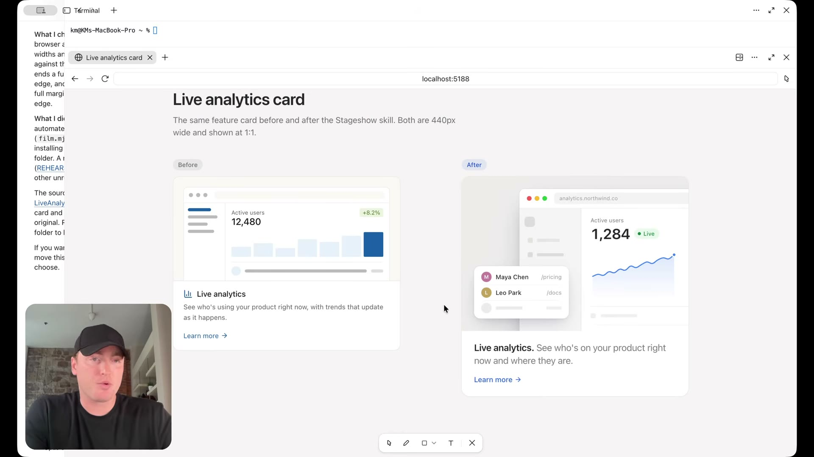

# Stageshow ile ürün sunumu

[09:21–10:36](https://www.youtube.com/watch?v=uzQCZD3w3hs&t=561s)

Ürün kartı önce ve sonra örneğiyle görsel sunum iyileştirmesi gösteriliyor; tam uygulama kalitesi testi yapılmıyor.

## İlgili konuşma

[09:21] There's another open source skill that was

[09:22] just released by the head of design at X and also SpaceX AI.

[09:27] And

[09:28] what this skill allows you to do is come up with better UI stills,

[09:32] animated product shots and sort of this bento grid style format that you see right here.

[09:37] What we're going to do, we're going to copy this command and then open up our

[09:41] favorite AI tool and before I installed the skill, what I had Claude do so we can

[09:45] compare before and after just come up with this basic card with a mock UI inside of it.

[09:49] So we just get this. We're to go ahead.

[09:51] We're going to install the skill now, but then we're going to run a prompt.

[09:53] So using the Stageshow skill we installed, update this card format as we can compare

[09:57] the before and after.

[09:58] Here you can now see the before and after

[10:00] and to get this kind of appearance here, both in like the UI visual and also the

[10:07] text treatment, it's not something I would be able to do just with a prompt or just

[10:11] basic instructions. So you can see with the before the icon,

[10:15] the way the text on different rows, the way the images in like the way the image

[10:19] is treated after it's just more of a much more elevated look and more premium

[10:25] appearance on something that you might see on like a really high quality.

[10:28] SAS site, just as an example.

[10:30] So when you're building your marketing pages or product demos,

[10:34] using this type of skill can really go a long way.

## İlgili kareler

Stageshow öncesi ve sonrası ürün kartları yan yana; sağ örnekte katmanlı arayüz, çizgi grafik ve farklı metin hiyerarşisi var.
